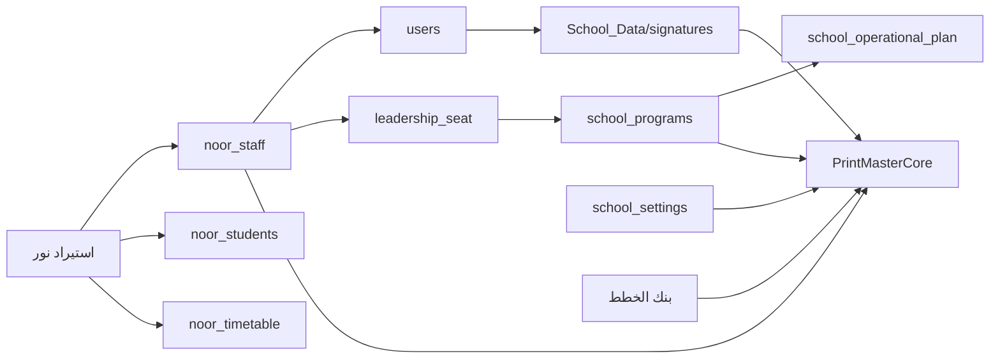

# بنية نظام الحوكمة

## الطبقات

- **الخادم:** FastAPI في `Core_Engine/app.py`. يشغّل بـ uvicorn. المسارات المحمية تقرأ الجلسة من الترويسة `X-Session-Token`.
- **البيانات:** SQLite ملف واحد. المسار من `DATABASE_PATH`، وإلا `School_Data/school_1059.db`. الاتصال من `Core_Engine/database.py` والدالة `connect()`.
- **الواجهة:** HTML وCSS وJavaScript بلا إطار خارجي، في `Print_Canvas`. الخطوط محلية. الألوان من متغيرات CSS.
- **الطباعة:** المتصفح. لا مكتبة PDF على الخادم. Chrome يحفظ الصفحة باسم `document.title`.

`master_core_engine.py` لا يُستورد من `app.py`.

## تدفق البيانات

الجداول التي يلمسها العمل اليومي:

- `noor_staff` و`noor_students` و`noor_timetable` و`nafes_timetable`: سجلات نور. الإخفاء بعمود `is_deleted` لا بحذف الصف.
- `users`: الدخول، و`signature_path` يشير إلى ملف التوقيع.
- `auth_sessions`: رمز الجلسة.
- `leadership_seat`: مقاعد المدير والوكلاء بأرقام الهوية.
- `school_programs`: البرامج ومسودة الاعتماد.
- `school_operational_plan`: الخطة الأم.
- `school_settings`: اسم المدرسة والرقم الإحصائي وبيانات المبنى.
- `evaluation_cycles` و`evaluation_indicators` و`improvement_actions`: التقويم وخطة التحسين.
- `audit_logs`: أثر التعديل. الصف يُضاف ولا يُحذف من الشاشة.

ملفات إلى جانب القاعدة، وما زالت داخل مجلد `School_Data` في المشروع:

- `signatures/sig_{id}.png`
- `council_minutes.json`
- `imports/` لملفات نور المرفوعة
- شواهد الصور التي يحفظها مسار الشاهد البصري

بنك الخطط يُقرأ من ملفات المعرفة عبر `/api/session/plans-bank`، لا يُخترع في المتصفح.

## نظام الطباعة

`PrintMasterCore.sheet` يبني مقالاً واحداً:

1. `thead` فيه الترويسة الرسمية من `OfficialFrameCore.header`. يتكرر أعلى كل صفحة.
2. جسم المحتوى. الجداول الطويلة تكمل في الصفحة التالية دون قص الصف.
3. الاعتماد من `OfficialFrameCore.signoff` بعد المحتوى، فيظهر في الصفحة الأخيرة.
4. تذييل ثابت بارتفاع 20 مم أسفل كل صفحة. `tfoot` يحجز هذا الارتفاع حتى لا يغطي التذييل السطر الأخير.

الإعدادات بالأرقام ثم تُكتب بالمليمتر: `headerHeight` 40، `footerHeight` 20، `contentMargin` 15، `showSignoff` افتراضياً نعم. `arm()` يضعها في `@page` قبل `window.print`.

المسارات التي تخرج من هذه النواة: سجل الطلاب، كشف المنسوبين، بطاقة البرنامج، محضر اللجان، الخطة التشغيلية، وملف تسليمات المعلم.

في Chrome: الهوامش «بلا»، ورسومات الخلفية مفعّلة. اسم الملف بلا `.pdf` لأن المتصفح يضيف الامتداد.

## استعادة النسخة الاحتياطية

من الإعدادات، المدير ينشئ نسخة. `create_backup()` في `Core_Engine/access.py` يكتب ملفاً باسم `school_1059_التاريخ.db` داخل مجلد `backups` الذي يقع بمستويين فوق ملف القاعدة. الاستعادة `POST /api/backups/restore` للمدير بعد التأكيد، وتنسخ ملف النسخة فوق القاعدة المفتوحة بواجهة النسخ في SQLite.

قبل النسخ يُوقف الاستخدام. بعد الاستعادة تُعاد فتح الصفحة حتى تُقرأ القاعدة من جديد.

إن نُقلت القاعدة بـ `DATABASE_PATH`، تبقى التوقيعات ومحاضر المجالس وملفات الاستيراد في `School_Data` الخاص بالمشروع. النسخة التي تُؤخذ من الإعدادات هي ملف القاعدة فقط. الإبقاء على المجلد كاملاً يحفظ التوقيع والمحضر مع القاعدة.

سلة المهملات (`is_deleted`) استعادة صف مخفي، وليست استعادة ملف النسخة.
