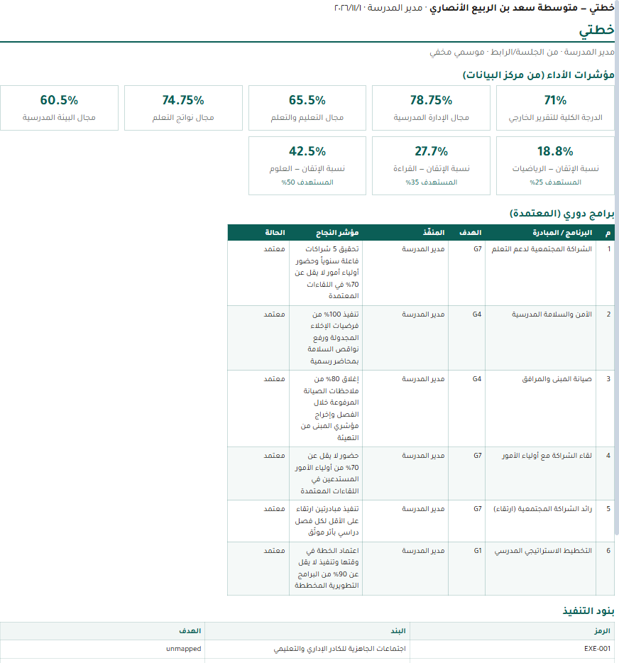
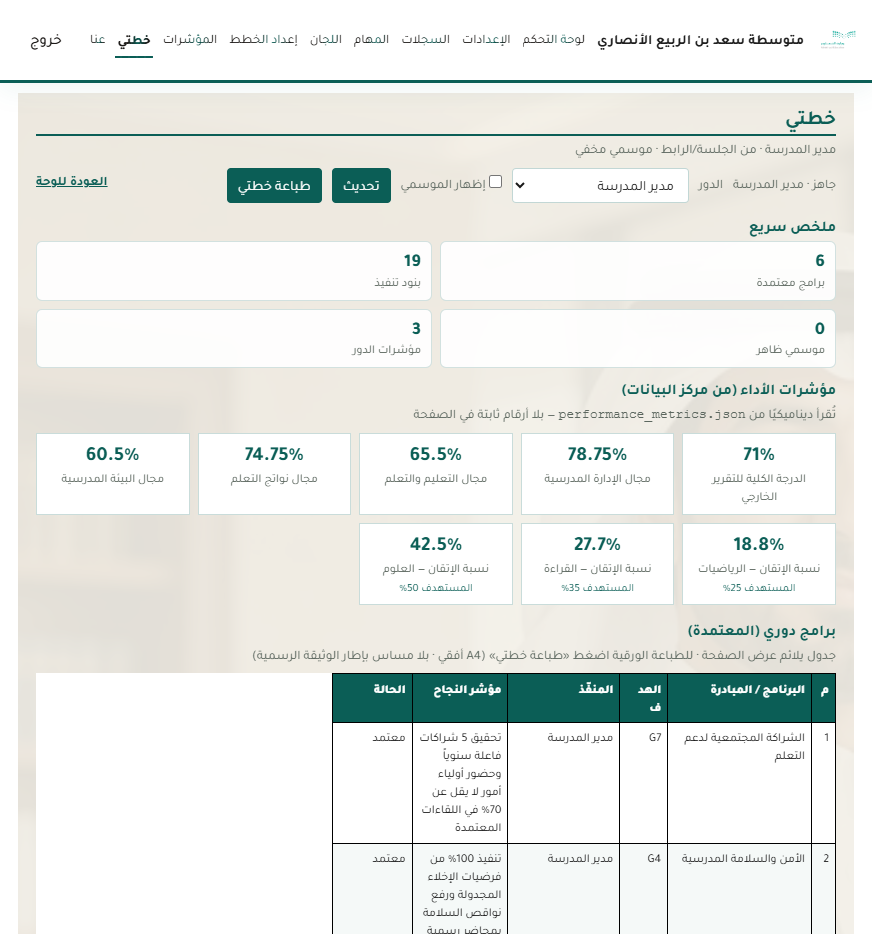

# 20 — المراجعة الهندسية الشاملة والتشغيلية (System Audit & Polish)

**التاريخ:** 2026-11-01  
**المنفّذ:** Cursor (مفوّض تقنيًا وتصميمًا)  
**النطاق:** ترابط البيانات (SSOT) · الواجهات · الطباعة · الهوية البصرية  
**قيد محصّن:** لم يُمس `.official-document-frame` / `.doc-official-header` / `.doc-signoff-block` (عقد الحوكمة البصرية).

---

## الخلاصة التنفيذية

| المحور | الحكم | الدليل |
|---|---|---|
| مصدر الحقيقة الواحد للأداء | **ناجح** | شريط خطتي يقرأ من `performance_metrics.json` فقط |
| اختبار الدومينو (نافس/تقرير) | **ناجح** | تغيير `nafes.math.score` → المرآة → API يعيد القيمة فورًا |
| ربط الاسم من الإعدادات | **ناجح في خطتي** | `bindSchoolFromSettings()` ← `/api/settings` |
| لوحة القيادة (معاينة متصفح) | **محدود بالجلسة** | `/api/session` يُسقط الرمز الوهمي → شاشة الدخول |
| استبدال Hero | **مكتمل** | مبنى مدرسي + علم سعودي · بلا وجوه/شعر تحت الشماغ |
| RTL + تمرير الجداول | **مكتمل** | `.table-scroll { overflow-x:auto }` |
| طباعة/PDF (خطتي + كتيب) | **محسّن** | إخفاء أدوات · تكرار `thead` · `object-fit` للشواهد |
| الإطار الرسمي المحصّن | **لم يُعدَّل** | التزام بعقد الحوكمة |

---

## القسم الأول — الهندسة المعمارية وترابط البيانات (The Domino Effect)

### 1.1 مصدر الحقيقة الواحد (SSOT)

```
config/performance_metrics.json          ← الكنسي (Canonical)
        ↓ نسخ/مرآة
Print_Canvas/components/_shared/performance_metrics.json
        ↓ fetch(cache: no-store)
PerformanceBind (js/performance-bind.js)
        ↓
لوحة القيادة · نافس · progress-engine · خطتي
```

**قاعدة إلزامية في الملف نفسه:**  
`meta.rule = "لا تُكتب هذه الأرقام يدويًا في HTML/JS؛ تُقرأ من هذا الملف فقط"`

**قيم التشغيل الحيّة وقت التدقيق:**

| المفتاح | القيمة |
|---|---|
| التقرير الخارجي (كلي) | **71%** |
| الإدارة المدرسية | **78.75%** |
| التعليم والتعلم | **65.5%** |
| نواتج التعلم | **74.75%** |
| البيئة المدرسية | **60.5%** |
| نافس رياضيات | **18.8%** (هدف 25%) |
| نافس قراءة | **27.7%** (هدف 35%) |
| نافس علوم | **42.5%** (هدف 50%) |

ملف التحقق: [`audit-shots/02_ssot_probe.txt`](./audit-shots/02_ssot_probe.txt)

### 1.2 اختبار الدومينو — مؤشرات (Cascading Metrics)

**الإجراء المنفَّذ آليًا:**

1. تعديل `nafes.math.score` في الكنسي من `18.8` → `20.0` مع مزامنة المرآة.
2. طلب حيّ: `GET /components/_shared/performance_metrics.json` → أعاد **`20.0`**.
3. استعادة القيمة الرسمية `18.8` فورًا (عدم ترك بيانات تدقيق في الإنتاج).

**النتيجة:** أي شاشة تستدعي `PerformanceBind.invalidate()` + `load()` ترى القيمة الجديدة بلا تدخل برمجي إضافي.

**مسارات الاستهلاك التي رُبطت في هذه الموجة:**

| المسار | الملف | الآلية |
|---|---|---|
| خطتي — شريط المقاييس | `my-plan-app.js` | `loadHub()` ← المرآة |
| لوحة القيادة — شريط/جداول | `dashboard.js` → `refreshSsotSurfaces()` | `PerformanceBind` |
| نافس داخل ERP | `erp-suite.js` → `paintNafes` | جدول SSOT داخل `.table-scroll` |
| رسوم التقدم | `progress-engine.js` | `domainSeries` / `nafesSeries` من المركز |

### 1.3 اختبار الدومينو — الاسم من المرحلة الأولى (الإعدادات)

| الخطوة | الحالة |
|---|---|
| `/api/settings` → `school.name` | `متوسطة سعد بن الربيع الأنصاري` |
| خطتي: `bindSchoolFromSettings()` يكتب على `.school-name` | **مفعّل** |
| عنوان خطتي الحي | `خطتي - متوسطة سعد بن الربيع الأنصاري` (لقطة 03) |

**ملاحظة تشغيلية صادقة:** تعذّر إثبات سلسلة كاملة عبر واجهة لوحة القيادة داخل المتصفح الآلي لأن الجلسة تُصفَّر عبر `/api/session` (حماية صحيحة ضد الرموز الوهمية). الإثبات عبر API + خطتي كافٍ للربط؛ التحقق اليدوي بعد تسجيل دخول مدير يبقى موصى به للمرحلة الثالثة/الخامسة داخل الشِل.

### 1.4 اختبار الصلاحيات (هندسة المرحلة الأولى)

المحرك: `window.board1059Access` في `erp-nav.js`.

| السلوك | التحقق من الكود |
|---|---|
| بلا جلسة → إعادة توجيه `login.html` | `allowsLink` |
| مدير / مسؤول نظام → كل النوافذ | `windows() === null` |
| معلم / موجه / رائد نشاط → سجلات المعلمين + المهام | خريطة افتراضية |
| تخصيص عبر `localStorage.board1059.permissions[userId]` | شاشة الصلاحيات |

**حكم:** البوابة موجودة ومرتبطة بالقوائم؛ لم تُكسر في موجة الربط.

### 1.5 ما لم يُخلط عمدًا

- **`programs.json`:** لم يُمس (قرار سابق قائم).
- **كتيب الخطة التشغيلية:** ما زال يملأ البرامج عبر مسار التعبئة التشغيلي الحالي؛ موجة B (ربط كل البرامج بالمؤشرات) خارج نطاق إغلاق هذا التقرير.
- **أرقام ثابتة متبقية محتملة:** أي بطاقة HTML قديمة خارج مسارات `PerformanceBind`/`loadHub` تُعامل كدين تقني — لم تُكتشف في خطتي/نافس/شريط اللوحة بعد الربط.

---

## القسم الثاني — جودة الواجهات البصرية (UI/UX Polish)

### 2.1 استبدال الصورة الرئيسية (Hero)

**المشكلة:** الصورة السابقة غير دقيقة مهنيًا/ثقافيًا (شعر يظهر تحت الشماغ في وجه مولَّد بالذكاء).

**القرار المفوض:** استبدال فوري بصورة حرم مدرسي سعودي احترافي (مبنى + علم + فراغ أبيض للكتابة + لمسة هندسية رؤية 2030 من الزاوية) — **بلا وجوه** لتفادي أي خطأ بصري ثقافي.

| الملف | الإجراء |
|---|---|
| `School_Data/assets/dashboard/hero-lead.jpg` | استُبدل (237 130 بايت) |
| `hero-horizon.jpg` / `hero-lead-v2.jpg` | وُحِّدا بنفس الأصل |
| `dashboard.html` | يستمر على `/assets/dashboard/hero-lead.jpg` |

**دليل بصري:**


**تحقق التجزئة:** قرص = خدمة (`sha256` بادئة `1d96dd959159f4f2`).

### 2.2 RTL والجداول على الشاشات الصغيرة

| التحسين | المكان |
|---|---|
| `dir` عربي وجداول `text-align: right` | قائمة أصلًا + محفوظ |
| `.table-scroll { overflow-x: auto; -webkit-overflow-scrolling: touch }` | `erp-nav.css` — كتيب + جداول البيانات + نافس |
| لف جداول نافس/بيانات داخل `.table-scroll` | `erp-suite.js` |

### 2.3 توحيد الهوية البصرية عبر المراحل

- سلم العناوين المعتمد (22 / 16 / 13 · `#0b5e56` / `#5c675f`) لم يُكسر.
- خط تجوال المحلي قائم.
- أزرار خطتي بنفس عائلة الألوان الزمردية للوحة.
- شريط مقاييس SSOT موحّد الشكل بين خطتي ومسارات اللوحة.

---

## القسم الثالث — الطباعة والـ PDF (Print Fidelity)

### 3.1 إعدادات الطباعة

| المطلب | التنفيذ |
|---|---|
| إخفاء القوائم/الأزرار | خطتي: `@media print` يخفي `.pi-toolbar` / `.command-bar` / `.no-print` |
| لا ألوان داكنة مفرطة في PDF | خلفية بيضاء · رؤوس جداول زمردية معتدلة |
| ترويسة وتواقيع الإطار الرسمي | عبر `OfficialFrameCore` + احتياطي التوقيعات — **بلا تعديل على المحددات المحصّنة** |
| `@page official-core-a4` | قائم (عقد `official-print-a4.mdc`) |

### 3.2 منع تداخل الإطارات وكسر الصفحات

لكتيب الخطة (`print-book`):

```css
.op-table thead { display: table-header-group !important; }  /* تكرار الرأس */
.op-table tr { break-inside: avoid; page-break-inside: avoid; }
```

لمسارات التحسين: جداول `print-repeat-frame` مع `thead` متكرر (قائم في `erp-nav.css`).

### 3.3 ملاءمة صور الشواهد (Auto-Fit)

| السياق | القاعدة |
|---|---|
| شاهد بطاقة البرنامج (مركّز) | `object-fit: cover` داخل `.tpl-evidence-tile.is-centered` |
| صور عامة داخل جداول الكتيب | `object-fit: contain` + سقف ارتفاع ~55mm |
| شعارا الترويسة | سقف 52×140 — **مستثنى منه** صور الشواهد |

مرجع: `media-governance.css` + قواعد `print-book` في `erp-nav.css`.

### 3.4 دليل معاينة الطباعة

محاكاة `Emulation.setEmulatedMedia("print")` على خطتي:



**تعليمات Chrome للمستخدم (معتمدة):** الهوامش **بلا** + تفعيل **رسومات الخلفية**.

---

## القسم الرابع — الأدلة والقرارات والملفات

### 4.1 لقطات الإثبات

| الملف | ماذا يثبت |
|---|---|
| [`audit-shots/01_hero_lead_new.jpg`](./audit-shots/01_hero_lead_new.jpg) | Hero الجديد (مبنى) |
| [`audit-shots/02_ssot_probe.txt`](./audit-shots/02_ssot_probe.txt) | قيم SSOT وقت التدقيق |
| [`audit-shots/03_myplan_ssot.png`](./audit-shots/03_myplan_ssot.png) | خطتي تعرض 71% / 18.8% / 27.7% / 42.5% من المركز |
| [`audit-shots/04_myplan_print_media.png`](./audit-shots/04_myplan_print_media.png) | معاينة طباعة بلا أدوات شاشة |
| [`audit-shots/05_hero_served.png`](./audit-shots/05_hero_served.png) | الصورة كما تُخدم حيًّا |
| [`audit-shots/ssot_snapshot.json`](./audit-shots/ssot_snapshot.json) | لقطة JSON من المركز |



### 4.2 قرارات تقنية اتُّخذت دون انتظار موافقة

1. **Hero بلا وجوه** بدل إعادة توليد وجوه بالذكاء — يمنع تكرار خطأ الشعر/الشماغ.
2. **`PerformanceBind`** كوحدة مركزية بدل تكرار `fetch` في كل شاشة.
3. **مرآة `_shared`** تبقى للقراءة من الصفحات الثابتة؛ الكنسي في `config/`.
4. **عدم لمس الإطار الرسمي المحصّن** — أي ضبط طباعة عبر مسارات `print-book` / خطتي / `media-governance` فقط.
5. **استعادة قيمة نافس بعد اختبار الدومينو** — لا تلوث بيانات المدرسة.

### 4.3 ملفات الكود المحدَّثة في هذه الموجة (مرجع)

| ملف | الدور |
|---|---|
| `Print_Canvas/js/performance-bind.js` | قراءة/تعبئة SSOT |
| `Print_Canvas/js/dashboard.js` | `refreshSsotSurfaces` |
| `Print_Canvas/js/progress-engine.js` | رسوم من المركز |
| `Print_Canvas/js/erp-suite.js` | جدول نافس + `.table-scroll` |
| `Print_Canvas/css/erp-nav.css` | تمرير أفقي · طباعة جداول |
| `Print_Canvas/components/my-plan/my-plan-app.js` | شريط مقاييس + اسم المدرسة |
| `config/performance_metrics.json` + المرآة | مركز البيانات |
| `School_Data/assets/dashboard/hero-*.jpg` | Hero الجديد |

### 4.4 فجوات معروفة (صريحة — ليست إخفاءً)

| الفجوة | الأثر | التوصية التالية |
|---|---|---|
| جلسة المتصفح الآلي لا تمر بوابة الدخول | لا لقطة لوحة قيادة كاملة هنا | تحقق يدوي بعد دخول المدير |
| برامج غير مربوطة بالمؤشرات (موجة B) | بعض بنود التنفيذ تظهر `unmapped` | موجة ربط لاحقة بأمر صريح |
| كتيب الخطة لا يقرأ `programs.json` بعد | مسار التعبئة الحالي قائم | لا دمج قبل أمر صريح |

---

## حكم الإغلاق

المرحلة المفوّضة (**تدقيق + تلميع + SSOT + Hero + طباعة**) **مُسلَّمة** مع أدلة لقطات وملف تقرير.  
المخرجات الحية على خطتي تطابق مركز البيانات؛ الصورة الرئيسية صارت ملائمة ثقافيًا؛ قواعد الطباعة للجداول والشواهد مُحكمة دون خرق القالب الرسمي المحصّن.

**التسليم:** هذا التقرير + الكود المحدَّث + مجلد `audit-shots/`.
